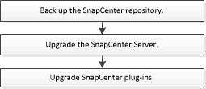

= SnapCenter 서버 업그레이드 워크플로
:allow-uri-read: 
:icons: font
:imagesdir: ../media/

[role="lead"]
SnapCenter의 각 릴리즈에는 업데이트된 SnapCenter 서버 및 플러그인 패키지가 포함되어 있습니다. 플러그인 패키지 업데이트는 SnapCenter 설치 프로그램과 함께 배포됩니다. SnapCenter에서 사용 가능한 업데이트를 확인하도록 구성할 수 있습니다.

워크플로에는 SnapCenter 서버와 플러그인 패키지를 업그레이드하기 위해 완료해야 하는 작업이 나열되어 있습니다.

[[recommended-upgrade-path]]
== 권장 업그레이드 경로

NetApp은 SnapCenter와의 호환성 및 최적의 성능을 보장하기 위해 지원되는 최신 SnapCenter 버전인 6.2.3으로 업그레이드할 것을 권장합니다.

CAUTION: 6.0 이전 버전 또는 6.0 버전에서 SnapCenter 6.2.3으로 업그레이드하려면 먼저 .NET 8 및 Java 11을 지원하는 6.1P3으로 업그레이드한 다음 .NET 10 및 Java 17을 지원하는 6.2.3으로 업그레이드하십시오. 이미 6.2.2 또는 그 외의 중간 버전을 사용하고 있지 않은 한, 업그레이드 과정에서 해당 버전을 사용하지 마십시오.

호스트 업그레이드에 대한 자세한 내용은 link:https://library.netapp.com/ecm/ecm_download_file/ECMLP3359467["SnapCenter 릴리스 노트"^]의 *호스트를 SnapCenter 6.2.3으로 업그레이드*를 참조하십시오.

[[supported-upgrade-paths]]
=== 지원되는 업그레이드 경로

이 섹션에서는 업그레이드할 수 있는 SnapCenter 버전과 지원되는 플러그인 버전을 보여줍니다.

NOTE: SnapCenter Server를 6.2로 업그레이드하는 경우 플러그인도 6.2로 업그레이드하세요.

|===
| SnapCenter 서버 버전을 사용 중인 경우... | SnapCenter 서버를 다음으로 직접 업그레이드할 수 있습니다. | 지원되는 플러그인 버전입니다 

.4+| 6.0.1 | 6.1  a| 
* 6.0.1
* 6.1

| 6.2  a| 
* 6.2

| 6.2.1  a| 
* 6.2.1

| 6.2.2  a| 
* 6.2.2

.4+| 6.1  a| 
6.2
 a| 
* 6.1
* 6.2

| 6.2.1  a| 
* 6.2.1

| 6.2.2  a| 
* 6.2.2

| 6.2.3  a| 
* 6.2.2
* 6.2.3

.3+| 6.2 | 6.2.1  a| 
* 6.2

| 6.2.2  a| 
* 6.2

| 6.2.3  a| 
* 6.2.2
* 6.2.3

|===
호스트를 SnapCenter 6.2.3으로 업그레이드하는 방법에 대한 자세한 내용은 link:https://library.netapp.com/ecm/ecm_download_file/ECMLP3359467["SnapCenter 릴리스 노트"^]의 *호스트를 SnapCenter 6.2.3으로 업그레이드*를 참조하십시오.

SnapCenter Plug-in for VMware vSphere 업그레이드하는 방법을 알아보려면 다음을 참조하세요. https://docs.netapp.com/us-en/sc-plugin-vmware-vsphere/scpivs44_upgrade.html["VMware vSphere용 SnapCenter 플러그인 업그레이드"^] .
